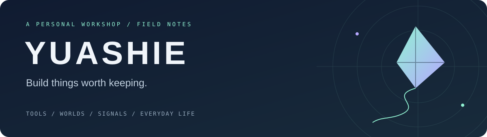

# 你好，我是 Yuashie 👋

**把兴趣写进代码，把想法做成日常可用的工具。**

[个人网站](https://yuashie.cn) · [项目仓库](https://github.com/southkite2023?tab=repositories) · [星账下载](https://yuashie.cn/projects/001/download)

---

我喜欢从具体的小需求开始：集中查看分散的账户余额，把追番排期放进日历，让 Minecraft 服务器与网站账号连起来，也给无线电通联留下一张电子 QSL。

这些看似不同的项目，慢慢组成了我的个人数字空间 **Yuashie**。我在这里记录它们从想法、原型到可用版本的过程，也继续学习怎样把界面、数据和实际使用体验做好。

## ✦ 正在打磨的作品

### 💫 星账 Astracct
**让分散的账户余额与费用，有一个清楚的查看入口。**

面向 Android、Windows 和 macOS 的账户余额与费用工具，覆盖已适配的 AI 服务、云服务和节点订阅接口。按账户、按币种呈现数据，并区分余额、费用、未知与查询失败；支持刷新、桌面悬浮余额模式及 Android 小组件。

`Flutter / Dart` · **公开测试版** · 实际服务商与设备兼容性持续验证中

[查看源码 →](https://github.com/southkite2023/quota-hub) · [下载与版本 →](https://github.com/southkite2023/quota-hub/releases)

### 🌐 Yuashie Personal Site
**一个持续生长的个人空间，也是各个项目相遇的地方。**

从作品展示延伸到账号、社区互动与跨设备偏好同步；连接 Minecraft 白名单桥接、无线电 QSO 日志与电子 QSL，并为星账提供下载入口。网站是这些兴趣的共同入口，也是一块持续迭代的实践场地。

`Vue 3 / Vite / Fastify / PostgreSQL` · **持续迭代**

[访问网站 →](https://yuashie.cn) · [查看源码 →](https://github.com/southkite2023/Netweb)

### 🗓 Yuashie Calendar
**让想追的更新，出现在每天都会打开的日历里。**

将更新排期整理为可订阅的 ICS 日历。目前已接入 AniList 的日本 TV 动漫播出数据，提供精确播出时间与仅开始日两种订阅；游戏版本、卡池、新作发售与自由组合订阅仍在规划和接入中。

`Python / ICS / GitHub Actions` · **真实动漫订阅已发布，更多来源建设中**

[查看项目 →](https://github.com/southkite2023/yuashie-calendar) · [订阅动漫排期 →](https://southkite2023.github.io/yuashie-calendar/calendar/real/v1/anime/span.ics)

播出排期来自 AniList 社区数据，可能调整；具体覆盖范围与验证进度见项目说明。

## ✦ 兴趣实验室

| 项目 | 想解决的问题 | 当前进度 |
| :--- | :--- | :--- |
| 🎮 [GamePulse](https://github.com/southkite2023/gamepulse) | 跨设备感知游戏匹配状态并发送通知 | 基础工程开发中 |
| 🀄 [雀镜 QueLens](https://github.com/southkite2023/QueLens) | 在微信小程序里学习成都血战到底牌型 | 正在搭建，尚未发布 |
| ⛏ [Minecraft Mods](https://github.com/southkite2023/Minecraft-Mods) | 从 Yuashie Core 开始探索 Fabric 模组开发 | 基础工程阶段，尚无玩法内容 |

📻 **还有一些兴趣，住在网站里。** 无线电模块记录 QSO、管理 QSL 模板并支持站内电子 QSL；Minecraft 白名单桥接则把网站账号与服务器连接起来。它们都收录在 [Netweb](https://github.com/southkite2023/Netweb) 中。

## ✦ 我的工具箱

| 方向 | 项目中使用的工具 |
| :--- | :--- |
| 界面与客户端 | Vue · Vite · JavaScript · Flutter · Dart |
| 服务与数据 | Fastify · PostgreSQL · Python |
| 游戏探索 | Java · Fabric · Paper |
| 部署与自动化 | Linux · Nginx · GitHub Actions |

比起不断扩充技术清单，我更在意这些工具能否把一个需求完整地接住：界面能读懂，数据有来处，更新能持续，出了问题也能找到原因。

## ✦ 接下来

- **星账**：继续打磨多端体验，补齐真实账户与设备验证。
- **订阅日历**：完善动漫订阅体验，逐步接入游戏与发售数据。
- **个人站点**：让账号、项目入口和日常使用更连贯。
- **兴趣实验**：推进 GamePulse、雀镜和 Minecraft 模组，从小范围可用开始。

---

**从一个自己会用的小工具开始，慢慢把它做好。**

欢迎通过各项目的 Issues 交流使用体验、问题和想法。

Yuashie · 北住孤居 Build · Explore · Record · Iterate

